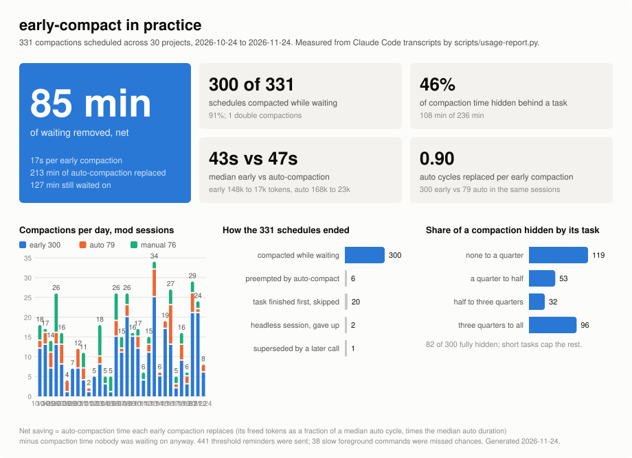

#  early-compact

A Claude Code mod that compacts the conversation while a background command runs, so compaction uses time you would spend waiting anyway instead of interrupting work later when auto-compact kicks in.

<picture>
  <source media="(prefers-color-scheme: dark)" srcset="docs/usage-dark.svg">
  
</picture>

Numbers from one user's transcripts from 2026-10-24 to 2026-11-15, since 0.3.0; see [Usage report](#usage-report) for how they are measured.

## How it works

1. Once context reaches the threshold, the next tool result carries a reminder telling the model to run any command that may take 15s or more with `run_in_background: true`, including tests and builds it would normally run in the foreground, then end its turn. The reminder is sent again only after context drops below the threshold and crosses it again.
2. A background Bash call that starts at or above the threshold schedules a compaction. Its result tells the model to end its turn if it is only waiting on the task.
3. When the main agent's turn ends normally and a scheduled task is still running, the mod calls `compact()`, with instructions naming the running tasks. The task's completion notice then resumes the model after compaction.
4. A foreground Bash call that takes 15s or more above the threshold gets a reminder after its result.

Details:

- Further background calls before the turn ends join the same schedule.
- If every scheduled task has finished by the turn end, or finishes while `compact()` is being retried, the compaction is skipped: there is nothing to overlap, and auto-compact would free more context later for the same cost.
- If the turn keeps going with a schedule pending and context grows 10 points past the threshold, the next tool result reminds the model once that a compaction is waiting on the turn ending. Otherwise auto-compact can land first.
- `compact()` refuses while a turn is running. The mod retries 8 times at 250ms intervals, then waits for one more turn end and tries again. After that it gives up.
- A turn that ends aborted or with an error drops the schedule: you are back at the keyboard, so the conversation is left alone.
- Subagents get no reminders, and their calls and turn ends don't schedule or trigger a compaction.
- Headless sessions (`claude -p`, the SDK) get nothing either: `compact()` is not available there between turns. A background command that ends with the final response sends no completion notice, so it schedules nothing.
- If the conversation is compacted some other way before the scheduled compaction runs (auto-compact, `/compact`, another plugin), the schedule is dropped.
- A long-lived background task (a dev server, a watcher) also schedules a compaction, which then runs at the turn end while you read the reply.
- A status line entry shows while compacting. A system row in the transcript (not sent to the model) reports when compaction is done, skipped, dropped or abandoned.

## Options

| Option | Default | Meaning |
| --- | --- | --- |
| `threshold` | 70 | Context fullness (%) at which a background Bash call schedules a compaction. |
| `nudge` | true | Shows a toast when a foreground Bash call takes 15s or more above the threshold, i.e. a missed chance. The model is reminded either way. |

## Usage report

`scripts/usage-report.py` reads every transcript under `~/.claude/projects` and reports how early compactions turned out: compacted, skipped and why, late, or doubled up with a neighbouring compaction (within 180s or 30k tokens of growth). It also estimates the time saved against auto-compaction. Overlap counts every task the compaction waited on, including ones that joined the schedule later in the turn.

```
python3 scripts/usage-report.py                     # Markdown report on stdout
python3 scripts/usage-report.py --since 2026-10-21  # skip anything before a local date
python3 scripts/usage-report.py --json calls.json   # also write one record per scheduled compaction
```

`--root` reads transcripts from another folder.

Claude Code deletes transcripts after about 30 days, so the report also reads the records it was computed from, stored as CSV in `data/`:

- `calls.csv`: one row per early-compact call, with its outcome, task span and compaction.
- `compactions.csv`: every compaction boundary, from any session.
- `events.csv`: threshold reminders, missed chances (15s+ foreground Bash above the threshold), and sessions that had the mod loaded.

Live transcripts take precedence over stored rows with the same id. `--save` writes the merged rows back; a weekly job (declared in `MAINTENANCE.md` at the repo root) runs it and commits the CSVs with the refreshed graphic. `--data` reads another folder and `--no-data` ignores it. Projects are stored as a hash of their folder name, so the report names a project only while one of its transcripts remains.

`scripts/usage-graphic.py` draws the headline numbers as the SVG above, in a light and a dark variant:

```
python3 scripts/usage-report.py --since 2026-10-24 --summary summary.json > /dev/null
python3 scripts/usage-graphic.py summary.json      # writes docs/usage-light.svg and docs/usage-dark.svg
```

## Install

At the prompt of a terminal session:

```
/plugin install early-compact --marketplace dreness/claude-mods
```

Answer `y` to add the marketplace, pick a scope, then set the options. From a shell: `claude plugin install early-compact --marketplace dreness/claude-mods`.

To run from a checkout instead: `claude --plugin-dir /path/to/plugins/early-compact`.

## Development

```
claude plugin test .                      # unit tests (tests/register.test.ts)
claude plugin validate .
npx -y -p typescript@5.6.3 tsc -p .       # needs .claude-plugin/types, laid when the engine loads the mod
```
